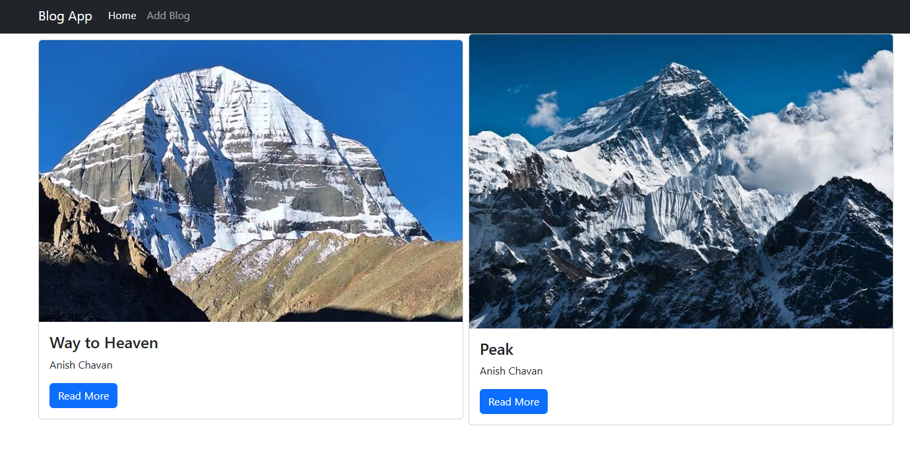
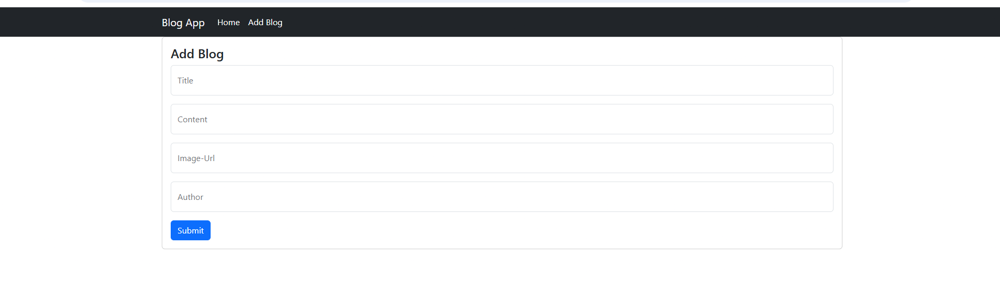
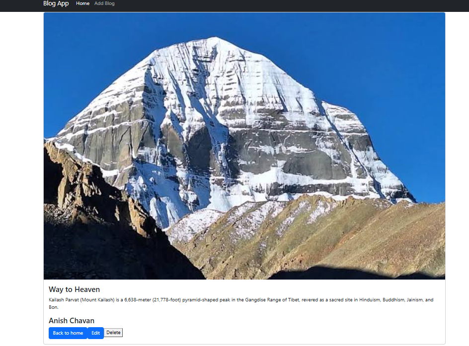
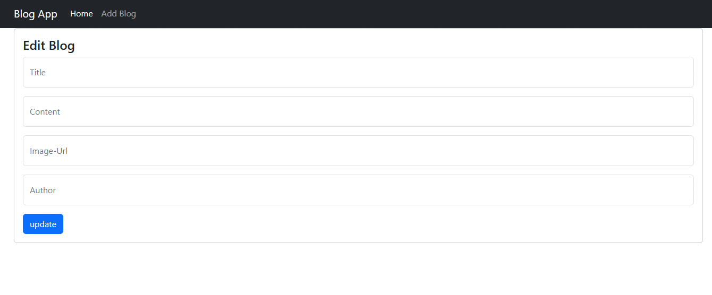

# Blog Management System

## Project Description

Blog Management System is a full-stack web application developed using the MERN stack. It allows users to create, view, update, and delete blog posts through a simple and user-friendly interface.

The application uses React.js for the frontend, Node.js and Express.js for the backend, and MongoDB for database management.

## Technologies Used

**Frontend:**
- React.js
- Bootstrap 5
- Axios
- React Router DOM
- HTML5
- CSS3
- Vite

**Backend:**
- Node.js
- Express.js
- MongoDB
- Mongoose
- CORS

## Features

- Display all available blog posts.
- Add new blog posts.
- View individual blog details.
- Edit existing blog posts.
- Delete blog posts.
- Navigate between pages using React Router.
- REST API integration using Axios.
- Store blog information in MongoDB.
- Responsive user interface using Bootstrap 5.

## Project Structure

```text
BlogManagementSystem/
│
├── Backend/
│   ├── controller/
│   │   └── controller.js
│   ├── model/
│   │   └── model.js
│   ├── router/
│   │   └── route.js
│   ├── db.js
│   └── app.js
│
├── frontend/
│   ├── public/
│   ├── src/
│   │   ├── assets/
│   │   ├── components/
│   │   │   ├── AddBlog.jsx
│   │   │   ├── EditBlog.jsx
│   │   │   ├── Home.jsx
│   │   │   ├── Navbar.jsx
│   │   │   └── ShowBlog.jsx
│   │   ├── App.jsx
│   │   ├── App.css
│   │   └── main.jsx
│   └── package.json
│
├── screenshots/
│   ├── homeBlog.png
│   ├── addBlog.png
│   ├── showmoreBlog.png
│   └── editBlog.png
│
└── README.md
```

## Screenshots

### 1. Home Page

Displays all available blog posts with their title, author, image, and Read More option.



### 2. Add Blog

Allows users to add a new blog by entering the title, content, image URL, and author details.



### 3. Show More Blog

Displays the complete details of an individual blog post.



### 4. Edit Blog

Allows users to update the existing blog information.



## API Routes

The application uses REST APIs to perform CRUD operations.

| Method | Endpoint | Description |
|---|---|---|
| POST | `/blog/add` | Add a new blog |
| GET | `/blog` | Display all blogs |
| GET | `/blog/blog/:id` | Display a single blog |
| PUT | `/blog/:id` | Update an existing blog |
| DELETE | `/blog/:id` | Delete a blog |

## Database

MongoDB is used as the database, with Mongoose for database connectivity and schema management.

**Database Name:** `i2`

**Collection:** `blogs`

Each blog contains the following fields:

- Title
- Content
- Image URL
- Author
- Created At
- Updated At

## Installation and Setup

### 1. Clone the Repository

```bash
git clone YOUR_GITHUB_REPOSITORY_LINK
```

### 2. Backend Setup

```bash
cd Backend
npm init -y
npm install express mongoose cors
```

### 3. Start Backend Server

```bash
npx nodemon app.js
```

Backend runs on:

`http://localhost:4000`

### 4. Frontend Setup

Open another terminal:

```bash
cd frontend
npm install
```

### 5. Start React Application

```bash
npm run dev
```

Open the local URL displayed by Vite in your browser.

**Note:** Make sure MongoDB is running locally before starting the backend server.

## Project Outcome

Successfully developed a full-stack Blog Management System using the MERN stack, implementing CRUD operations and REST API integration.

This project provides practical experience in React.js, Express.js, Node.js, MongoDB, and frontend-backend communication.

---

**Developed using the MERN Stack.**